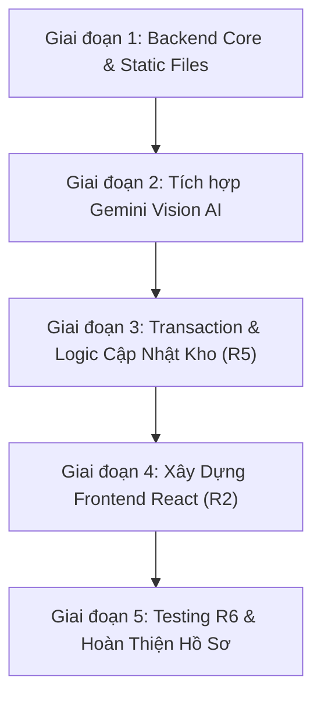

# KẾ HOẠCH & PHÂN TÍCH TRIỂN KHAI DỰ ÁN
## AI Product Defect Inspection & Quality Control Assistant

---

## 1. TỔNG QUAN ĐỀ TÀI & MỤC TIÊU CỐT LÕI

- **Tên đề tài**: AI Product Defect Inspection & Quality Control Assistant (Trợ lý kiểm định khuyết tật sản phẩm & Quản lý chất lượng bằng AI).
- **Mục tiêu**: Phát triển ứng dụng Web full-stack sử dụng **Multimodal AI (Google Gemini Vision)** để tự động phân tích hình ảnh sản phẩm, phát hiện và phân loại các khuyết tật sản xuất/lưu kho, ghi nhận báo cáo kiểm định chất lượng (QC), và cập nhật trạng thái kho hàng sau khi người dùng (nhân viên QC) xác nhận.

### Kiến trúc công nghệ (Technology Stack)
| Thành phần | Công nghệ yêu cầu | Trạng thái hiện tại |
| :--- | :--- | :--- |
| **Database** | SQL Server + Entity Framework Core (Code First) | **Hoàn thành** (Đã tạo 4 Entity, cấu hình DbContext & Seed Data) |
| **Backend** | ASP.NET Core Web API (.NET 10) | Đang cấu hình cơ bản, cần triển khai Services & Endpoints |
| **AI Service** | Google Gemini API (Multimodal / Vision) | Chưa tích hợp |
| **Frontend** | React.js | Chưa khởi tạo dự án |

---

## 2. HIỆN TRẠNG DỰ ÁN (ĐÃ HOÀN THÀNH)

- [x] Phân tích lược đồ dữ liệu 4 thực thể: `Product`, `Inspector`, `DefectCategory`, `InspectionReport`.
- [x] Thiết kế Entities trong `MultimodalAI_API/Entities/`.
- [x] Tạo `AppDbContext`, cấu hình quan hệ khóa ngoại (1:N) và dữ liệu mẫu (`HasData`).
- [x] Cấu hình Connection String (`MSSQLLocalDB` / `MultimodalAI_DB`) trong `appsettings.json`.
- [x] Đăng ký `AppDbContext` vào DI container trong `Program.cs`.
- [x] Tạo Migration ban đầu (`InitialCreate`) và chạy `database update` thành công vào SQL Server.

---

## 3. LỘ TRÌNH CÁC BƯỚC TIẾP THEO (ROADMAP)



---

### GIAI ĐOẠN 1: HOÀN THIỆN BACKEND CORE & QUẢN LÝ STATIC FILES (R3)

#### Bước 1.1: Cấu hình Static Files & Thư mục Upload (`wwwroot/uploads`)
- Tạo thư mục `wwwroot/uploads` trong dự án `MultimodalAI_API` để lưu ảnh sản phẩm tải lên.
- Cấu hình `app.UseStaticFiles()` trong `Program.cs` để cho phép truy cập xem ảnh qua đường dẫn URL tĩnh (ví dụ: `https://localhost:port/uploads/filename.jpg`).
- Bật cấu hình CORS trong `Program.cs` để Frontend React sau này có thể gọi API mà không bị chặn.

#### Bước 1.2: Xây dựng hệ thống DTOs (Data Transfer Objects)
Tạo thư mục `Dtos/` để chuẩn hóa dữ liệu nhận/trả qua API, tránh lộ trực tiếp Entity:
- **ProductDTOs**: `ProductReadDto`, `ProductUpdateStockDto`.
- **InspectorDTOs**: `InspectorReadDto`.
- **DefectCategoryDTOs**: `DefectCategoryReadDto`.
- **InspectionDTOs**:
  - `AnalyzeImageRequestDto` (nhận `IFormFile image`, `int productId`, `int inspectorId`).
  - `GeminiVisionResultDto` (kết quả AI trả về: `DefectCategoryName`, `SeverityLevel`, `ConfidenceScore`, `Description`, `QualityStatus`, `IsImageClear`).
  - `ConfirmInspectionReportDto` (thông tin sau khi nhân viên QC kiểm tra và bấm xác nhận để lưu DB).
  - `InspectionReportReadDto` (dùng hiển thị lịch sử ở Dashboard).

#### Bước 1.3: Tạo các RESTful API Controllers cơ bản (R3)
- `ProductsController`:
  - `GET /api/products`: Danh sách sản phẩm (kèm thông tin kho `TotalStock`, `PassedStock`, `FailedStock`).
  - `GET /api/products/{id}`: Chi tiết sản phẩm.
- `InspectorsController`:
  - `GET /api/inspectors`: Danh sách nhân viên QC để hiển thị ở Dropdown chọn người kiểm tra.
- `DefectCategoriesController`:
  - `GET /api/defect-categories`: Danh sách các loại lỗi để hiển thị và map với kết quả AI.
- `InspectionReportsController`:
  - `GET /api/inspection-reports`: Lấy danh sách lịch sử kiểm định (hỗ trợ phân trang, lọc theo sản phẩm hoặc trạng thái Pass/Fail).
  - `GET /api/inspection-reports/{id}`: Chi tiết báo cáo kiểm định.

---

### GIAI ĐOẠN 2: TÍCH HỢP MULTIMODAL AI (GOOGLE GEMINI VISION) (R4)

#### Bước 2.1: Cấu hình API Key & Thư viện Gemini
- Đăng ký Google Gemini API Key tại Google AI Studio.
- Cấu hình key vào `appsettings.json`:
  ```json
  "Gemini": {
    "ApiKey": "YOUR_GEMINI_API_KEY",
    "Model": "gemini-1.5-flash"
  }
  ```
- Cài đặt thư viện HTTP Client hoặc SDK gọi Gemini API (dùng `System.Net.Http.Json` hoặc thư nguyên thức chính thức của Google).

#### Bước 2.2: Thiết kế `GeminiVisionService`
- Tạo interface `IGeminiVisionService` và implementation `GeminiVisionService` trong `Services/`.
- Chuyển đổi file ảnh sang định dạng Base64 hoặc luồng nhị phân (stream).
- **Prompt Engineering chuyên sâu (tối ưu hóa Tiếng Việt theo R4)**:
  - Yêu cầu AI đóng vai trò Chuyên gia Kiểm định Chất lượng (QC Inspector).
  - Phân tích ảnh chụp sản phẩm và trả về **định dạng JSON có cấu trúc (Structured Output)**:
    ```json
    {
      "isImageClear": true,
      "defectDetected": true,
      "matchedCategory": "Trầy xước bề mặt (Surface Scratch)",
      "severityLevel": "Minor",
      "defectDescription": "Mô tả chi tiết vị trí và mức độ khuyết tật bằng tiếng Việt",
      "confidenceScore": 0.95,
      "suggestedQualityStatus": "Failed"
    }
    ```
- **Xử lý ngoại lệ ảnh theo yêu cầu R4**:
  - Nhận diện ảnh bị mờ, lóa sáng, góc chụp không rõ ràng (`isImageClear = false`) và trả thông báo nhắc nhở người dùng chụp lại.
  - Xử lý các lỗi mạng, lỗi mã trạng thái 403 (sai key) hoặc 429 (Rate Limit) với cơ chế Retry / Báo lỗi rõ ràng.

#### Bước 2.3: Tạo Endpoint phân tích ảnh sơ bộ
- `POST /api/inspections/analyze`:
  - Tiếp nhận `multipart/form-data` gồm file ảnh, `productId`, `inspectorId`.
  - Lưu file tạm thời vào `wwwroot/uploads`.
  - Gọi `GeminiVisionService` để phân tích hình ảnh.
  - Trả kết quả JSON về cho client để chuẩn bị bước **Review & Confirmation** (chưa cập nhật kho ngay).

---

### GIAI ĐOẠN 3: TRANSACTION & TỰ ĐỘNG CẬP NHẬT KHO (R5)

#### Bước 3.1: Nghiệp vụ Xác nhận Báo cáo & Giao dịch nguyên tử (Atomic Database Transaction)
Theo yêu cầu **R5**, khi người dùng xem lại thông tin AI phát hiện và bấm **Xác nhận (Confirm)**:
- Sử dụng `IDbContextTransaction` để đảm bảo tính toàn vẹn (ACID):
  ```csharp
  using var transaction = await _context.Database.BeginTransactionAsync();
  try
  {
      // 1. Lưu bản ghi InspectionReport (IsUserConfirmed = true)
      // 2. Tìm Product theo ProductId
      // 3. Cập nhật tồn kho:
      //    - Nếu QualityStatus == "Passed": Tăng PassedStock lên 1
      //    - Nếu QualityStatus == "Failed": Tăng FailedStock lên 1
      // 4. Lưu thay đổi vào DB
      await _context.SaveChangesAsync();
      
      // 5. Commit transaction
      await transaction.CommitAsync();
  }
  catch (Exception)
  {
      await transaction.RollbackAsync();
      throw;
  }
  ```

#### Bước 3.2: Endpoint xác nhận báo cáo kiểm định
- `POST /api/inspections/confirm`:
  - Nhận `ConfirmInspectionReportDto` (cho phép QC chỉnh sửa lần cuối mô tả lỗi hoặc ghi đè trạng thái Pass/Fail trước khi lưu).
  - Thực thi giao dịch nguyên tử như trên và trả về kết quả số lượng tồn kho mới nhất.

---

### GIAI ĐOẠN 4: PHÁT TRIỂN GIAO DIỆN FRONTEND (REACT.JS) (R2)

#### Bước 4.1: Khởi tạo dự án React
- Khởi tạo dự án React (sử dụng Vite + React) trong thư mục `MultimodalAI_Client`.
- Cài đặt các thư viện cần thiết:
  - Routing: `react-router-dom`
  - HTTP Client: `axios`
  - Giao diện & Biểu đồ: `lucide-react`, thư viện UI (`Ant Design` hoặc `TailwindCSS`), `recharts` / `chart.js` để vẽ biểu đồ thống kê.

#### Bước 4.2: Xây dựng 3 Module giao diện chính theo yêu cầu đề:

1. **QC Dashboard (Bảng điều khiển quản lý chất lượng)**:
   - Các thẻ thống kê (Metric Cards): Tổng số lượng kiểm định, Tỷ lệ đạt chuẩn (% Pass Rate), Tỷ lệ lỗi (% Defect Rate), Tổng hàng lỗi.
   - Biểu đồ phân bố lỗi: Tần suất xuất hiện theo từng `DefectCategory` và mức độ nghiêm trọng `SeverityLevel`.
   - Bảng lịch sử kiểm định gần nhất (Recent Inspections Table) hiển thị ảnh thu nhỏ (thumbnail), sản phẩm, trạng thái Pass/Fail (Badge màu xanh/đỏ).

2. **Upload Form (Biểu mẫu tải ảnh & kiểm tra)**:
   - Dropdown chọn `Product` cần kiểm định.
   - Dropdown chọn `Inspector` phụ trách.
   - Khu vực kéo thả / chọn ảnh sản phẩm từ máy tính (Drag & Drop Zone).
   - Hiển thị xem trước ảnh ngay lập tức (Image Preview).
   - Nút hành động "Phân tích với Gemini Vision" kèm hiệu ứng tải (Loading spinner / skeleton).

3. **Preview Form & Review Confirmation (Biểu mẫu xem trước & xác nhận AI)**:
   - Hiển thị kết quả AI trích xuất bên cạnh ảnh sản phẩm:
     - Badge trạng thái đề xuất: `PASSED` (Xanh lá) hoặc `FAILED` (Đỏ).
     - Điểm tin cậy: `Confidence Score` (ví dụ: 96.5%).
     - Loại khuyết tật & Mức độ nghiêm trọng (`SeverityLevel`).
     - Đoạn mô tả chi tiết khuyết tật bằng tiếng Việt.
   - Cho phép nhân viên QC xác nhận thông tin hoặc điều chỉnh mô tả nếu cần.
   - Nút "Xác nhận & Cập nhật kho" -> Gọi API `POST /confirm` -> Thông báo thành công & chuyển hướng về Dashboard.

---

### GIAI ĐOẠN 5: KIỂM THỬ, DỮ LIỆU MẪU & BÀN GIAO (R6 & DELIVERABLES)

#### Bước 5.1: Chuẩn bị 4 kịch bản ảnh kiểm thử thực tế (R6 Test Scenarios)
Thu thập hoặc chuẩn bị 4 ảnh mẫu vào thư mục tài nguyên test:
1. **Ảnh 1 (Good)**: Sản phẩm hoàn hảo, không có khuyết tật -> AI nhận diện `QualityStatus = Passed`, `DefectCategory = No Defect`.
2. **Ảnh 2 (Minor Defect)**: Sản phẩm có vết trầy xước nhẹ hoặc vết ố ngoài vỏ -> AI phân loại `SeverityLevel = Minor`.
3. **Ảnh 3 (Major Defect)**: Sản phẩm bị nứt, vỡ, cong vênh nghiêm trọng -> AI phân loại `SeverityLevel = Major / Critical`, `QualityStatus = Failed`.
4. **Ảnh 4 (Faulty / Unclear Image)**: Ảnh bị mờ nhòe, tối hoặc không thể xác định chi tiết -> AI kích hoạt cơ chế báo ảnh không hợp lệ (`isImageClear = false`).

#### Bước 5.2: Hoàn thiện tài liệu & Bàn giao sản phẩm (Deliverables)
- [x] Kiểm tra toàn bộ luồng hoạt động từ Client -> API -> Gemini Vision -> Database Transaction -> Cập nhật kho.
- [x] Tạo bộ 4 hình ảnh kiểm thử thực tế (Good, Minor Defect, Major Defect, Unclear) trong thư mục `TestImages/`.
- [x] Viết tài liệu `README.md` đầy đủ chuẩn mực (Kiến trúc Page 3 PDF, ERD, API specs, Setup guide, Test Scenarios, Email template).
- [ ] Quay video ngắn (Short video) demo các endpoints hoạt động và giao diện người dùng theo kịch bản trong `README.md`.
- [x] Đẩy toàn bộ source code lên Git repository.
- [ ] Chuẩn bị email nộp bài theo mẫu.

---

## 4. CHECKLIST TIẾN ĐỘ THEO DÕI

- [x] **R1. Database Design & Management**: Entities, DbContext, HasData seed, Migration ban đầu.
- [x] **R3. Static File & RESTful APIs**: `wwwroot/uploads`, Controllers cho Products, Inspectors, Categories, Reports.
- [x] **R4. AI-Powered Data Extraction**: Gemini Vision Service, Prompt JSON tiếng Việt, xử lý ảnh mờ/lỗi.
- [x] **R5. Report Validation & Inventory Updates**: `IDbContextTransaction`, cập nhật `PassedStock`/`FailedStock`.
- [x] **R2. React User Interface**: Setup Vite/React, Dashboard thống kê, Upload form, Preview & Review form.
- [x] **R6. Testing & Documentation**: Tạo 4 ảnh kịch bản `TestImages/`, hoàn thiện `README.md`.
- [ ] **Deliverables Final**: Quay video clip demo và gửi email nộp bài.

