```mermaid
flowchart LR
    subgraph S1["1. USER INTERFACE (REACT)"]
        UI1["Tải ảnh / Chọn tiêu chí"] --> UI2["Xem trước ảnh Live Preview"]
    end

    subgraph S2["2. WEB API BACKEND (.NET 10)"]
        API1["Nhận multipart/form-data"] --> API2["Lưu trữ ảnh vào wwwroot/uploads"]
        API2 --> API3["Chuyển đổi Base64 / Stream"]
    end

    subgraph S3["3. GEMINI VISION SERVICE"]
        AI1["Google Gemini Vision API"] --> AI2["Phân tích khuyết tật đa phương thức"]
        AI2 --> AI3["Trả về JSON có cấu trúc (Tiếng Việt)"]
    end

    subgraph S4["4. REVIEW & CONFIRMATION"]
        REV1["Hiển thị kết quả AI đề xuất"] --> REV2["QC Review, hiệu chỉnh & bấm Xác nhận"]
    end

    subgraph S5["5. DATABASE TRANSACTION (EF CORE)"]
        DB1["Khởi tạo IDbContextTransaction"] --> DB2["Lưu InspectionReport (IsUserConfirmed = true)"]
        DB2 --> DB3["Cập nhật PassedStock / FailedStock"]
        DB3 --> DB4["Commit Transaction & Cập nhật Dashboard"]
    end

    UI2 -->|POST /api/inspectionreports/analyze| API1
    API3 -->|Payload Base64 + Prompt| AI1
    AI3 -->|JSON kết quả| REV1
    REV2 -->|POST /api/inspectionreports/confirm| DB1
    DB4 -.->|Real-time update| UI1
```

# AI Product Defect Inspection & Quality Control Assistant

Hệ thống kiểm định khuyết tật sản phẩm và quản lý chất lượng (QC) tự động ứng dụng **Multimodal AI (Google Gemini Vision)**, xây dựng trên nền tảng **ASP.NET Core Web API (.NET 10)**, **SQL Server với Entity Framework Core (Code First)** và **React.js**.

---

## 📑 MỤC LỤC
1. [Giới thiệu Dự án](#1-giới-thiệu-dự-án)
2. [Luồng Hoạt động (Workflow)](#2-luồng-hoạt-động-workflow)
3. [Công nghệ Sử dụng (Technology Stack)](#3-công-nghệ-sử-dụng-technology-stack)
4. [Đặc tả RESTful API Endpoints](#4-đặc-tả-restful-api-endpoints)
5. [Kịch bản Kiểm thử Thực tế (R6 Testing Scenarios)](#5-kịch-bản-kiểm-thử-thực-tế-r6-testing-scenarios)
6. [Hướng dẫn Cài đặt & Khởi chạy (Getting Started)](#6-hướng-dẫn-cài-đặt--khởi-chạy-getting-started)

---

## 1. GIỚI THIỆU DỰ ÁN

**AI Product Defect Inspection Assistant** là giải pháp hỗ trợ nhân viên QC trên dây chuyền sản xuất:
- **Tự động phân tích**: Sử dụng **Multimodal AI (Google Gemini Vision)** nhận diện khuyết tật bề mặt/cấu trúc từ ảnh chụp sản phẩm.
- **Phân loại & Đánh giá**: Phân loại mức độ lỗi (*None, Minor, Major, Critical*), tính điểm tin cậy (*Confidence Score*) và đề xuất trạng thái (*Passed/Failed*).
- **Kiểm soát & Xác nhận (Review & Confirm)**: Nhân viên QC xem trước kết quả AI, hiệu chỉnh mô tả và quyết định phê duyệt.
- **Cập nhật kho tự động**: Sử dụng **giao dịch nguyên tử (Atomic Database Transaction)** để lưu báo cáo và đồng bộ số lượng tồn kho (*PassedStock*, *FailedStock*) tức thời.

---

## 2. LUỒNG HOẠT ĐỘNG (WORKFLOW)

Quy trình xử lý khép kín 5 bước theo thiết kế hệ thống:



### Chi tiết 5 bước thực thi:
1. **User Uploads**: Nhân viên QC chọn sản phẩm, nhân viên phụ trách và tải ảnh lên từ giao diện React.
2. **Backend Processes**: API tiếp nhận `IFormFile`, xác thực định dạng/dung lượng và lưu ảnh vào `wwwroot/uploads`.
3. **Gemini Analyzes**: Chuyển đổi dữ liệu ảnh sang Base64, gọi Google Gemini Vision API với prompt tiếng Việt chuẩn hóa JSON (có cơ chế Retry / Fallback khi gặp lỗi 503/429).
4. **Review & Confirm**: Hiển thị kết quả AI trích xuất bên cạnh ảnh xem trước. Nhân viên QC kiểm tra, điều chỉnh mô tả lỗi nếu cần rồi nhấn xác nhận.
5. **Database Transaction**: Khởi tạo `IDbContextTransaction` lưu `InspectionReport`, cập nhật kho hàng (`PassedStock` / `FailedStock`), commit giao dịch và phản hồi cập nhật Dashboard.

---

## 3. CÔNG NGHỆ SỬ DỤNG (TECHNOLOGY STACK)

| Thành phần | Công nghệ | Chi tiết |
| :--- | :--- | :--- |
| **Frontend** | React.js (Vite) | React 19, Lucide React, Modern CSS System |
| **Backend** | ASP.NET Core Web API | .NET 10, C# 13, Controllers, Dependency Injection |
| **Database** | SQL Server | Microsoft Entity Framework Core 10, Code First Migrations |
| **AI Service** | Google Gemini Multimodal API | `gemini-3.5-flash`, `gemini-3.1-flash-lite`, Structured JSON |
| **Static Files** | Static File Middleware | Quản lý và phục vụ ảnh tại `wwwroot/uploads` |

---

## 4. ĐẶC TẢ RESTFUL API ENDPOINTS

Base URL: `http://localhost:5223`

| STT | Phương thức | Đường dẫn API | Chức năng nghiệp vụ |
| :---: | :---: | :--- | :--- |
| 1 | `GET` | `/api/products` | Lấy danh sách sản phẩm kèm số lượng tồn kho (`TotalStock`, `PassedStock`, `FailedStock`) |
| 2 | `GET` | `/api/products/{id}` | Lấy chi tiết thông tin sản phẩm |
| 3 | `GET` | `/api/inspectors` | Lấy danh sách nhân viên QC |
| 4 | `GET` | `/api/defectcategories` | Lấy danh mục phân loại khuyết tật |
| 5 | `GET` | `/api/inspectionreports` | Lấy lịch sử kiểm định (hỗ trợ lọc theo `productId` và `qualityStatus`) |
| 6 | `GET` | `/api/inspectionreports/{id}`| Lấy chi tiết một báo cáo kiểm định |
| 7 | `POST` | `/api/inspectionreports/analyze` | Tải ảnh lên (`multipart/form-data`) & phân tích khuyết tật với Gemini Vision AI |
| 8 | `POST` | `/api/inspectionreports/confirm` | Xác nhận báo cáo, thực thi `IDbContextTransaction` và tự động cập nhật kho |

---

## 5. KỊCH BẢN KIỂM THỬ THỰC TẾ (R6 TESTING SCENARIOS)

Dự án đã chuẩn bị sẵn bộ 4 hình ảnh kiểm thử thực tế trong thư mục [`TestImages/`](./TestImages/) để phục vụ chạy thử cho các tình huống:
1. **`01_good_product.jpg`**: Tình huống sản phẩm đạt chuẩn (*Passed / Không có lỗi*).
2. **`02_minor_scratch.jpg`**: Tình huống sản phẩm có lỗi nhẹ (*Failed - Minor: Trầy xước bề mặt*).
3. **`03_major_cracked.jpg`**: Tình huống sản phẩm có lỗi nặng (*Failed - Major: Nứt vỡ cấu trúc*).
4. **`04_unclear_blurry.jpg`**: Tình huống ảnh không đạt chuẩn (*Ảnh mờ/tối/không rõ chi tiết, AI cảnh báo chụp lại*).

---

## 6. HƯỚNG DẪN CÀI ĐẶT & KHỞI CHẠY (GETTING STARTED)

### 6.1. Yêu cầu môi trường
- [.NET SDK 10.0](https://dotnet.microsoft.com/)
- [Node.js (LTS v18+)](https://nodejs.org/) & npm
- SQL Server (MSSQLLocalDB đi kèm Visual Studio hoặc SQL Server Express)

### 6.2. Cấu hình Gemini API Key
Cấu hình API Key của bạn vào file `MultimodalAI_API/appsettings.json`:
```json
{
  "Logging": {
    "LogLevel": {
      "Default": "Information",
      "Microsoft.AspNetCore": "Warning"
    }
  },
  "ConnectionStrings": {
    "DefaultConnection": "Server=(localdb)\\MSSQLLocalDB;Database=MultimodalAI_DB;Trusted_Connection=True;TrustServerCertificate=True;"
  },
  "Gemini": {
    "ApiKey": "YOUR_GOOGLE_GEMINI_API_KEY",
    "Model": "gemini-3.5-flash"
  },
  "AllowedHosts": "*"
}
```

### 6.3. Cập nhật Cơ sở dữ liệu (Migration)
Mở terminal tại thư mục gốc và chạy lệnh để tự động tạo Database `MultimodalAI_DB` cùng dữ liệu mẫu ban đầu:
```bash
cd MultimodalAI_API
dotnet ef database update
```

### 6.4. Khởi chạy Backend Web API
Tại thư mục `MultimodalAI_API`:
```bash
dotnet run
```
- API chạy tại: `http://localhost:5223`
- Tài liệu Swagger UI: `http://localhost:5223/swagger`

### 6.5. Khởi chạy Frontend React
Mở terminal mới tại thư mục `MultimodalAI_Client`:
```bash
cd MultimodalAI_Client
npm install
npm run dev
```
- Ứng dụng chạy tại: `http://localhost:5173`
