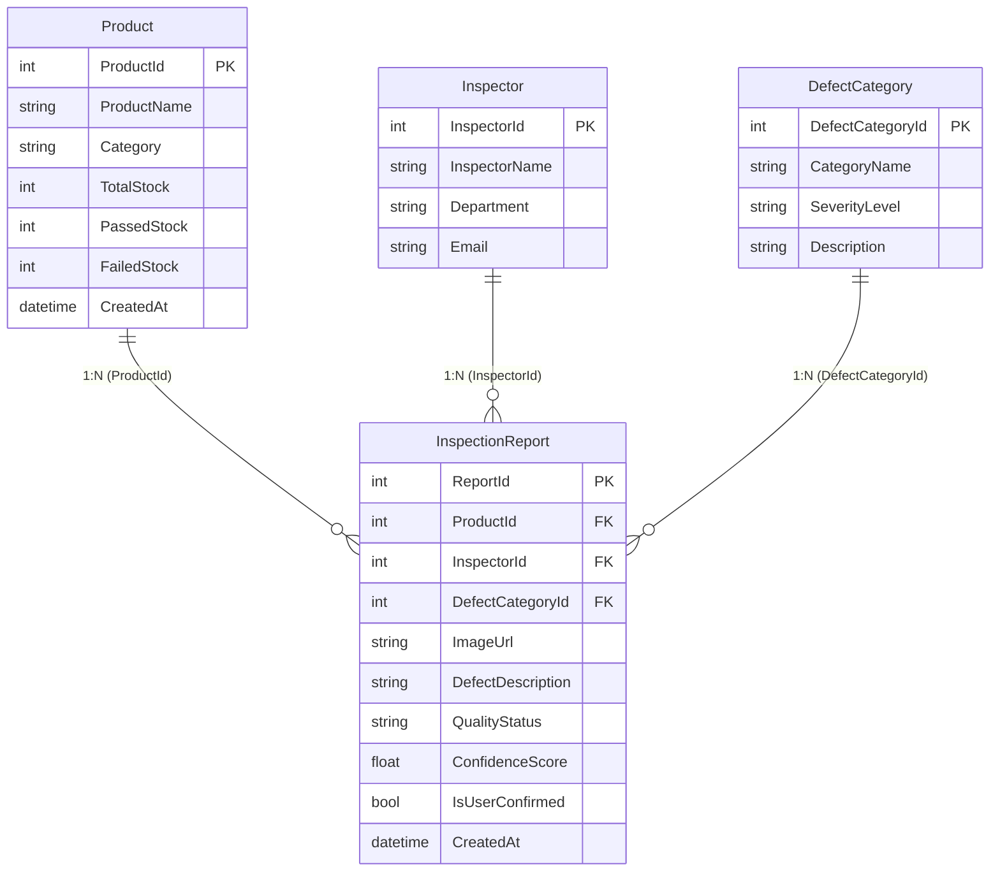

# AI Product Defect Inspection & Quality Control Assistant

Hệ thống kiểm định khuyết tật sản phẩm và quản lý chất lượng (QC) tự động ứng dụng **Multimodal AI (Google Gemini Vision)**, xây dựng trên nền tảng **ASP.NET Core Web API (.NET 10)**, **SQL Server với Entity Framework Core (Code First)** và **React.js**.

---

## 📑 MỤC LỤC
1. [Giới thiệu Dự án](#1-giới-thiệu-dự-án)
2. [Sơ đồ Kiến trúc & Luồng Hoạt động (Workflow)](#2-sơ-đồ-kiến-trúc--luồng-hoạt-động-workflow)
3. [Công nghệ Sử dụng (Technology Stack)](#3-công-nghệ-sử-dụng-technology-stack)
4. [Mô hình Dữ liệu (Database Design & ERD)](#4-mô-hình-dữ-liệu-database-design--erd)
5. [Đặc tả RESTful API Endpoints](#5-đặc-tả-restful-api-endpoints)
6. [Kịch bản Kiểm thử Thực tế (R6 Testing Scenarios)](#6-kịch-bản-kiểm-thử-thực-tế-r6-testing-scenarios)
7. [Hướng dẫn Cài đặt & Khởi chạy (Getting Started)](#7-hướng-dẫn-cài-đặt--khởi-chạy-getting-started)
8. [Kịch bản Quay Video Demo (Video Presentation Guide)](#8-kịch-bản-quay-video-demo-video-presentation-guide)
9. [Bàn giao & Mẫu Email Nộp bài (Deliverables)](#9-bàn-giao--mẫu-email-nộp-bài-deliverables)

---

## 1. GIỚI THIỆU DỰ ÁN

Trong dây chuyền sản xuất và lưu kho hiện đại, việc kiểm tra chất lượng sản phẩm (Quality Control - QC) thủ công thường tốn nhiều thời gian và dễ xảy ra sai sót do cảm quan chủ quan của con người. 

**AI Product Defect Inspection Assistant** giải quyết bài toán này bằng cách:
- Tiếp nhận hình ảnh chụp sản phẩm từ nhân viên QC trên dây chuyền.
- Tự động trích xuất đặc trưng và phân tích khuyết tật bề mặt/cấu trúc thông qua mô hình **Multimodal AI (Google Gemini Vision)**.
- Phân loại mức độ lỗi (*None, Minor, Major, Critical*), chấm điểm độ tin cậy (*Confidence Score*) và đề xuất trạng thái (*Passed/Failed*).
- Cho phép nhân viên QC xác nhận hoặc hiệu chỉnh thông tin (Review & Confirmation).
- Tự động cập nhật số lượng tồn kho (*PassedStock*, *FailedStock*) thông qua **giao dịch nguyên tử (Atomic Database Transaction)** nhằm đảm bảo tính toàn vẹn dữ liệu.

---

## 2. SƠ ĐỒ KIẾN TRÚC & LUỒNG HOẠT ĐỘNG (WORKFLOW)

Dự án hiện thực hóa chính xác kiến trúc 5 bước được quy định trong tài liệu thiết kế hệ thống (Trang 3 Đề bài):

```mermaid
flowchart LR
    subgraph S1["1. USER INTERFACE (REACT)"]
        UI1["Tải ảnh / Chọn tiêu chí"] --> UI2["Xem trước ảnh Live Preview"]
    end

    subgraph S2["2. WEB API BACKEND (.NET 10)"]
        API1["Nhận multipart/form-data"] --> API2["Lưu trữ ảnh vào wwwroot/uploads"]
        API2 --> API3["Chuyển đổi Base64 / Stream"]
    end

    subgraph S3["3. GEMINI VISION SERVICE"]
        AI1["Google Gemini Vision API"] --> AI2["Phân tích khuyết tật đa phương thức"]
        AI2 --> AI3["Trả về JSON có cấu trúc (Tiếng Việt)"]
    end

    subgraph S4["4. REVIEW & CONFIRMATION"]
        REV1["Hiển thị kết quả AI đề xuất"] --> REV2["QC Review, hiệu chỉnh & bấm Xác nhận"]
    end

    subgraph S5["5. DATABASE TRANSACTION (EF CORE)"]
        DB1["Khởi tạo IDbContextTransaction"] --> DB2["Lưu InspectionReport (IsUserConfirmed = true)"]
        DB2 --> DB3["Cập nhật PassedStock / FailedStock"]
        DB3 --> DB4["Commit Transaction & Cập nhật Dashboard"]
    end

    UI2 -->|POST /api/inspectionreports/analyze| API1
    API3 -->|Payload Base64 + Prompt| AI1
    AI3 -->|JSON kết quả| REV1
    REV2 -->|POST /api/inspectionreports/confirm| DB1
    DB4 -.->|Real-time update| UI1
```



### Chi tiết các bước xử lý:
1. **User Uploads**: Nhân viên QC chọn sản phẩm, nhân viên phụ trách và tải ảnh lên từ giao diện React.
2. **Backend Processes**: Controller tiếp nhận file qua `IFormFile`, xác thực định dạng/dung lượng và lưu ảnh vật lý vào `wwwroot/uploads`.
3. **Gemini Analyzes**: Chuyển đổi dữ liệu ảnh sang Base64, gửi kèm System Prompt tối ưu hóa Tiếng Việt và Schema JSON chuẩn cho Google Gemini API (tích hợp cơ chế tự động thử lại Retry và Fallback khi gặp lỗi 503/429).
4. **Review & Confirm**: Giao diện hiển thị trực quan thông tin AI tìm thấy (loại lỗi, mức độ nghiêm trọng, mô tả chi tiết, điểm tin cậy) bên cạnh ảnh chụp. Nhân viên kiểm định có quyền xem xét, điều chỉnh trước khi bấm xác nhận.
5. **Save to Database**: Thực thi giao dịch nguyên tử `IDbContextTransaction`: lưu bản ghi `InspectionReport`, tăng số lượng `PassedStock` hoặc `FailedStock` tương ứng của sản phẩm, sau đó commit và phản hồi tức thời lên QC Dashboard.

---

## 3. CÔNG NGHỆ SỬ DỤNG (TECHNOLOGY STACK)

| Thành phần | Công nghệ | Phiên bản / Thư viện chính |
| :--- | :--- | :--- |
| **Frontend** | React.js | Vite, React 19, Lucide React, Modern CSS System |
| **Backend** | ASP.NET Core Web API | .NET 10, C# 13, Controllers, Dependency Injection |
| **Database** | SQL Server | Microsoft Entity Framework Core 10, Code First Migrations |
| **AI Service** | Google Gemini Multimodal API | `gemini-3.5-flash`, `gemini-3.1-flash-lite`, Structured JSON |
| **Quản lý file tĩnh** | Static File Middleware | Lưu trữ tập trung tại `wwwroot/uploads` |

---

## 4. MÔ HÌNH DỮ LIỆU (DATABASE DESIGN & ERD)

Cơ sở dữ liệu được thiết kế theo đúng quy chuẩn quan hệ trong đề bài (Trang 1):



---

## 5. ĐẶC TẢ RESTFUL API ENDPOINTS

Hệ thống cung cấp đầy đủ các RESTful API endpoints tại Base URL `http://localhost:5223`:

| STT | Phương thức | Đường dẫn API | Chức năng nghiệp vụ | Yêu cầu nghiệp vụ |
| :---: | :---: | :--- | :--- | :---: |
| 1 | `GET` | `/api/products` | Lấy danh sách sản phẩm kèm số lượng tồn kho | R3, R5 |
| 2 | `GET` | `/api/products/{id}` | Lấy chi tiết thông tin sản phẩm | R3 |
| 3 | `GET` | `/api/inspectors` | Lấy danh sách nhân viên QC | R3 |
| 4 | `GET` | `/api/defectcategories` | Lấy danh mục phân loại khuyết tật | R3 |
| 5 | `GET` | `/api/inspectionreports` | Lấy lịch sử kiểm định (hỗ trợ lọc theo `productId` và `qualityStatus`) | R2, R3 |
| 6 | `GET` | `/api/inspectionreports/{id}`| Lấy chi tiết một báo cáo kiểm định | R3 |
| 7 | `POST` | `/api/inspectionreports/analyze` | Upload file ảnh (`multipart/form-data`) & phân tích khuyết tật với Gemini Vision | **R4** |
| 8 | `POST` | `/api/inspectionreports/confirm` | Xác nhận báo cáo, thực thi `IDbContextTransaction` và tự động cập nhật kho | **R5** |

---

## 6. KỊCH BẢN KIỂM THỬ THỰC TẾ (R6 TESTING SCENARIOS)

Dự án đã chuẩn bị sẵn bộ 4 hình ảnh kiểm thử thực tế trong thư mục [`TestImages/`](file:///d:/APTECH/HK3/4.%20GANA/MultimodalAI/MultimodalAI/TestImages/) để phục vụ chấm điểm và chạy thử:

| Tên File Mẫu | Kịch bản kiểm thử | Mô tả ảnh | Kết quả AI kỳ vọng | Hành vi hệ thống |
| :--- | :--- | :--- | :--- | :--- |
| `01_good_product.jpg` | **Sản phẩm Đạt chuẩn (Good)** | Mặt lưng smartphone mới 100%, bề mặt sạch đẹp, không tì vết. | • `isImageClear`: `true`<br>• `defectDetected`: `false`<br>• `defectCategoryId`: `1` (*Không có lỗi*)<br>• `qualityStatus`: `"Passed"`<br>• `confidenceScore`: `> 0.85` | Hiện badge xanh `PASSED`. Khi Confirm: tăng `PassedStock` +1. |
| `02_minor_scratch.jpg` | **Lỗi nhẹ (Minor Defect)** | Mặt lưng điện thoại có vết trầy xước nhẹ ở lớp vỏ ngoài. | • `isImageClear`: `true`<br>• `defectDetected`: `true`<br>• `defectCategoryId`: `2` (*Trầy xước bề mặt*)<br>• `severityLevel`: `"Minor"`<br>• `qualityStatus`: `"Failed"` | Hiện badge đỏ `FAILED`, mô tả đúng vết xước. Khi Confirm: tăng `FailedStock` +1. |
| `03_major_cracked.jpg` | **Lỗi nặng (Major Defect)** | Sản phẩm bị nứt vỡ lớn, biến dạng góc thân máy nghiêm trọng. | • `isImageClear`: `true`<br>• `defectDetected`: `true`<br>• `defectCategoryId`: `3` (*Nứt vỡ cấu trúc*)<br>• `severityLevel`: `"Major"` hoặc `"Critical"`<br>• `qualityStatus`: `"Failed"` | Cảnh báo lỗi nghiêm trọng. Khi Confirm: tăng `FailedStock` +1. |
| `04_unclear_blurry.jpg` | **Ảnh mờ / Không đạt chuẩn (Unclear)** | Ảnh chụp bị rung tay, nhòe mờ, góc chụp tối không thấy sản phẩm. | • `isImageClear`: `false`<br>• `confidenceScore`: `0.0`<br>• `defectDescription`: *"Ảnh mờ hoặc không rõ chi tiết, vui lòng chụp lại."* | Giao diện cảnh báo ảnh không hợp lệ, không cho phép lưu sai dữ liệu vào hệ thống. |

---

## 7. HƯỚNG DẪN CÀI ĐẶT & KHỞI CHẠY (GETTING STARTED)

### 7.1. Yêu cầu môi trường
- [.NET SDK 10.0](https://dotnet.microsoft.com/)
- [Node.js (LTS v18+)](https://nodejs.org/) & npm
- SQL Server (MSSQLLocalDB đi kèm Visual Studio hoặc SQL Server Express)

### 7.2. Cấu hình Gemini API Key
Cấu hình API Key của bạn vào file `MultimodalAI_API/appsettings.Development.json`:
```json
{
  "Logging": {
    "LogLevel": {
      "Default": "Information",
      "Microsoft.AspNetCore": "Warning"
    }
  },
  "Gemini": {
    "ApiKey": "YOUR_GOOGLE_GEMINI_API_KEY",
    "Model": "gemini-3.5-flash"
  }
}
```
*(Ghi chú: File `appsettings.Development.json` đã được đưa vào `.gitignore` để tránh rò rỉ secret lên GitHub).*

### 7.3. Cập nhật Cơ sở dữ liệu (Migration)
Mở terminal tại thư mục gốc của dự án và chạy lệnh sau để tự động tạo Database `MultimodalAI_DB` và nạp dữ liệu mẫu ban đầu:
```bash
cd MultimodalAI_API
dotnet ef database update
```

### 7.4. Khởi chạy Backend Web API
Tại thư mục `MultimodalAI_API`:
```bash
dotnet run
```
- Web API khởi chạy tại: `http://localhost:5223`
- Swagger UI tài liệu API: `http://localhost:5223/swagger`

### 7.5. Khởi chạy Frontend React
Mở một cửa sổ terminal mới và chuyển vào thư mục `MultimodalAI_Client`:
```bash
cd MultimodalAI_Client
npm install
npm run dev
```
- Mở trình duyệt truy cập: `http://localhost:5173`

---

## 8. KỊCH BẢN QUAY VIDEO DEMO (VIDEO PRESENTATION GUIDE)

Video demo đáp ứng yêu cầu *"Short video of the endpoints that have been run"* với thời lượng tối ưu từ **3 đến 5 phút**:

### Phân đoạn 1: Demo các RESTful API trên Swagger UI (1.5 phút)
1. Mở `http://localhost:5223/swagger`.
2. Thực thi `GET /api/Products` để thấy số lượng kho ban đầu (`TotalStock: 150`, `PassedStock: 142`, `FailedStock: 8`).
3. Thực thi `POST /api/InspectionReports/analyze`: chọn ảnh mẫu từ `TestImages/01_good_product.jpg`, bấm Execute -> Show kết quả JSON phản hồi từ Gemini Vision AI.
4. Thực thi `POST /api/InspectionReports/confirm`: gửi payload xác nhận -> Show mã phản hồi `200 OK`.
5. Gọi lại `GET /api/Products/2`: Chứng minh tồn kho đã tự động nhảy số (`PassedStock` tăng lên 143) nhờ Database Transaction.

### Phân đoạn 2: Demo trải nghiệm người dùng trên React UI (2.5 phút)
1. Mở `http://localhost:5173` -> Giới thiệu **QC Dashboard** với các chỉ số thống kê, bảng tỷ lệ đạt/lỗi.
2. Vào màn hình **Kiểm định ảnh mới**:
   - Thử nghiệm với file `TestImages/01_good_product.jpg` -> AI nhận diện Đạt (`PASSED`) -> Bấm Xác nhận.
   - Thử nghiệm với file `TestImages/02_minor_scratch.jpg` -> AI nhận diện Lỗi bề mặt (`FAILED` - Minor) -> Bổ sung ghi chú -> Bấm Xác nhận.
   - Thử nghiệm với file `TestImages/04_unclear_blurry.jpg` -> AI cảnh báo ảnh mờ, yêu cầu chụp lại.
3. Chuyển sang tab **Lịch sử kiểm định**: Xem danh sách các lượt kiểm tra vừa thực hiện kèm ảnh thumbnail và thông tin chi tiết.
4. Quay về **Dashboard**: Đối chiếu và thấy các biểu đồ, con số tồn kho đã được đồng bộ chuẩn xác.

---

## 9. BÀN GIAO & MẪU EMAIL NỘP BÀI (DELIVERABLES)

### 9.1. Thông tin Bàn giao
- **Source Code Repository**: [https://github.com/sangho2105/MultimodalAI](https://github.com/sangho2105/MultimodalAI)
- **Video Demo Link**: *[Chèn đường dẫn video YouTube hoặc Google Drive tại đây]*
- **Sinh viên thực hiện**: Sang Ho
- **Môn học**: Advanced Multi-platform Application Development / GANA

### 9.2. Mẫu Email nộp bài
```text
Tiêu đề: [APTECH] Nộp bài Assignment: AI Product Defect Inspection & Quality Control Assistant - [Họ và Tên] - [Mã Sinh Viên]

Kính gửi: Thầy/Cô Bộ môn và Ban Giám khảo,

Em xin phép gửi bài nộp cho đồ án "AI Product Defect Inspection & Quality Control Assistant":

1. Link Git Repository (Full-stack Source Code):
   https://github.com/sangho2105/MultimodalAI

2. Link Video Demo (Kiểm thử Endpoints & Giao diện người dùng):
   [Link Google Drive / YouTube của bạn]

3. Tài liệu tóm tắt dự án:
   Chi tiết kiến trúc hệ thống, hướng dẫn cài đặt và các kịch bản kiểm thử (Test Scenarios) đã được trình bày đầy đủ tại file README.md trong repository.

Em xin chân thành cảm ơn Thầy/Cô!
Trân trọng,
[Họ và Tên của bạn]
[Số điện thoại liên hệ]
```